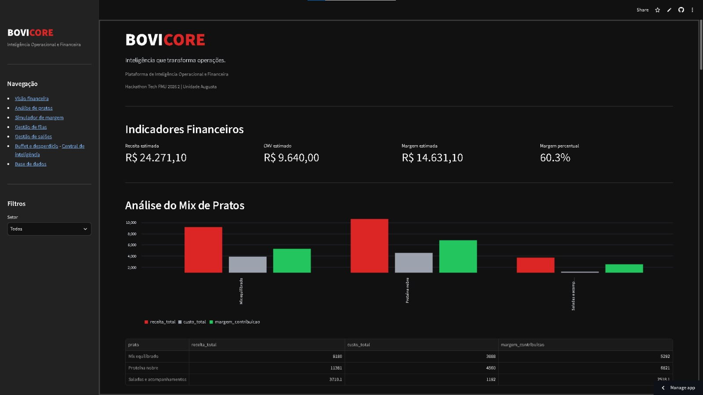
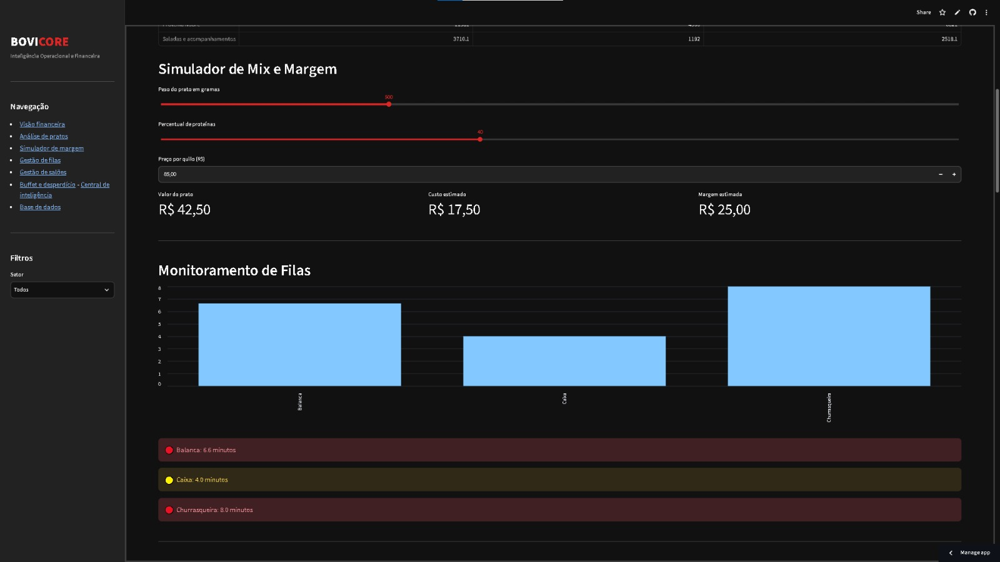
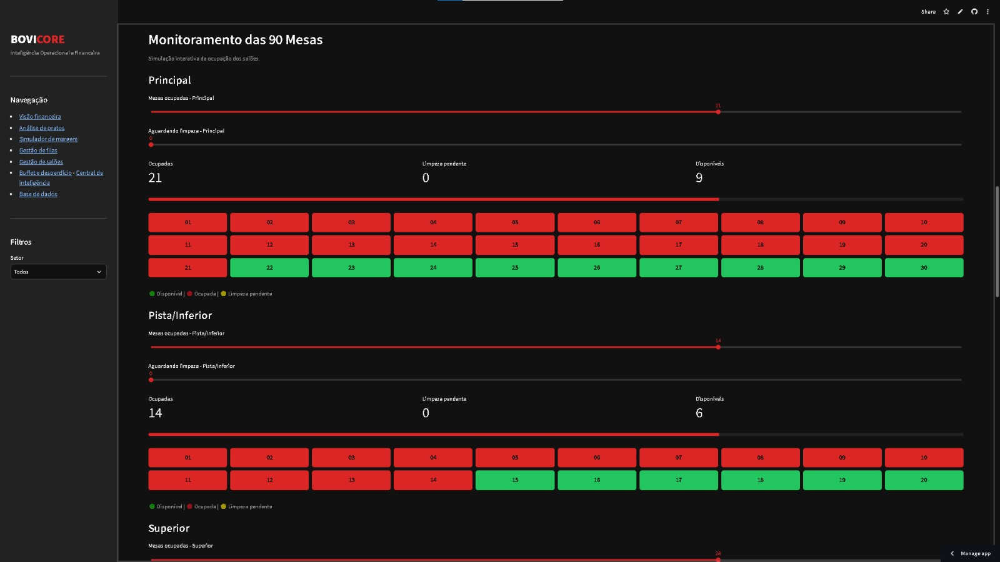
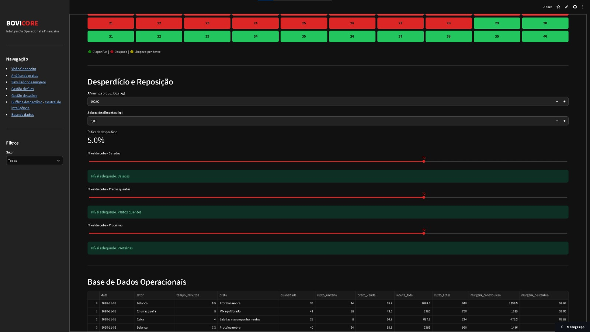
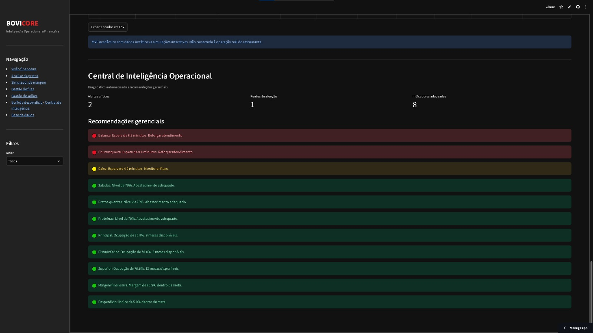

# BoviCore

**Inteligência que transforma operações.**

Plataforma de Inteligência Operacional e Financeira desenvolvida para o Hackathon Tech FMU 2026.2, com foco na gestão do Bovinu's Grill & Beer — Unidade Augusta.

## Acesse a plataforma

https://bovicore.streamlit.app/

## Sobre o projeto

O BoviCore foi desenvolvido com o objetivo de transformar dados operacionais e financeiros em informações estratégicas, auxiliando a tomada de decisão na gestão de restaurantes.

A plataforma centraliza indicadores de desempenho, identifica gargalos operacionais e apresenta recomendações gerenciais automatizadas.

## Funcionalidades

- Indicadores financeiros de receita, CMV e margem.
- Análise do mix de pratos.
- Simulador de margem financeira.
- Monitoramento de filas e tempos de espera.
- Gestão de 90 mesas distribuídas em três salões.
- Monitoramento de ocupação e limpeza.
- Controle de abastecimento das cubas do buffet.
- Análise de desperdício de alimentos.
- Central de Inteligência Operacional.
- Alertas e recomendações gerenciais automatizadas.
- Filtragem de dados por setor.
- Exportação de dados em CSV.

## Tecnologias utilizadas

- Python
- Pandas
- Streamlit
- GitHub
- Streamlit Community Cloud

## Estrutura do projeto

- app.py — Interface, indicadores e funcionalidades da plataforma.
- database.py — Consulta e tratamento da base de dados.
- data/ — Armazenamento dos dados utilizados.
- .streamlit/ — Configurações visuais da aplicação.
- requirements.txt — Dependências do projeto.
- README.md — Documentação.

## Metodologia

O projeto utiliza dados sintéticos, análises descritivas, indicadores de desempenho, simulações interativas e regras automatizadas de classificação de alertas.

## Resultados esperados

- Redução dos gargalos operacionais.
- Melhor aproveitamento da capacidade dos salões.
- Redução do desperdício de alimentos.
- Maior controle dos custos.
- Otimização da margem financeira.
- Apoio à tomada de decisão gerencial.

## Limitações

O BoviCore é um Produto Mínimo Viável (MVP) acadêmico. Os dados e cenários apresentados são simulados, sem integração direta com a operação real do restaurante. Os benefícios apresentados são resultados esperados, ainda não validados em ambiente real.

## Contexto acadêmico

**Hackathon Tech FMU 2026.2**

Ciência de Dados aplicada à inteligência operacional e financeira.

---

**BOVICORE — Inteligência que transforma operações.**

---

## Demonstração da plataforma

### 1. Visão financeira e análise do mix de pratos

Painel de indicadores financeiros, permitindo acompanhar receitas, custos, margens e o desempenho dos diferentes tipos de pratos.

### 2. Simulador de margem e monitoramento de filas

Simulação interativa da composição dos pratos e identificação de gargalos operacionais nos pontos de atendimento.

### 3. Monitoramento das 90 mesas

Gestão visual da ocupação dos três salões, identificando mesas ocupadas, disponíveis e aguardando limpeza.

### 4. Controle de desperdício e reposição

Monitoramento dos níveis de abastecimento das cubas e cálculo do índice de desperdício de alimentos.

### 5. Central de Inteligência Operacional

Diagnóstico automatizado dos indicadores financeiros e operacionais, com classificação de criticidade e recomendações gerenciais para auxiliar a tomada de decisão.

---

**BoviCore — Inteligência que transforma operações.**

Hackathon Tech FMU 2026.2

## Materiais oficiais de apresentação

- [Apresentação PowerPoint](./BoviCore%20-%20Apresenta%C3%A7%C3%A3o%20final.pptx)
- [Vídeo demonstrativo](./Apresenta%C3%A7%C3%A3o%20v%C3%ADdeo%20-%20BoviCore.mp4)
- [Acesse a plataforma BoviCore](https://bovicore.streamlit.app/)

## Equipe BoviCore

- Renato Gomes Mistretta
- Fernando Diógenes Santos
- Rodrigo Lemos Poletti

**Hackathon Tech FMU 2026.2**

Transformamos dados em decisões, decisões em eficiência e eficiência em resultados.
